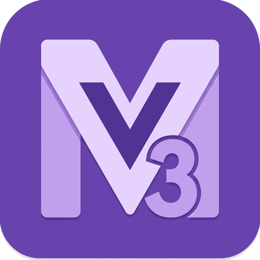

<p align="center">
  
</p>

<p align="center">
  <strong>M3UI Vue</strong>
</p>

<p align="center">
  Material Design 3 component library for Vue 3 + Tailwind CSS v4
</p>

<p align="center">
  <a href="https://www.npmjs.com/package/@m3ui-vue/m3ui-vue"></a>
  <a href="https://www.npmjs.com/package/@m3ui-vue/m3ui-vue"></a>
  
  
  
</p>

---

135+ tree-shakeable components following [Material Design 3](https://m3.material.io/) guidelines. Ships with 40 color palettes, dark mode, i18n support, and full TypeScript coverage.

## Getting Started

### Install

```bash
pnpm add @m3ui-vue/m3ui-vue
```

### Fonts

`MIcon` and every component that renders an icon just apply the `material-symbols-outlined` class from `theme.css` — the library ships the CSS rule (sizing, `font-feature-settings`, etc.) but **not** the font file itself, so you need to supply `Material Symbols Outlined` (and `Roboto`) yourself, via one of two options:

**Option A — Google Fonts CDN (default, simplest).** Add to your `index.html` `<head>`:

```html
<link
  href="https://fonts.googleapis.com/css2?family=Roboto:wght@400;500;700&family=Roboto+Mono:wght@400&family=Material+Symbols+Outlined:opsz,wght,FILL,GRAD@20..48,100..700,0..1,-50..200&display=swap"
  rel="stylesheet"
/>
```

**Option B — self-hosted (offline / no third-party requests).** The CDN link needs network access to `fonts.googleapis.com`, which won't work offline or behind a restrictive firewall. Install [`material-symbols`](https://www.npmjs.com/package/material-symbols) (ships the `.woff2` files locally) and import it from your main stylesheet instead of the CDN link:

```bash
pnpm add material-symbols
```

```css
@import 'material-symbols/outlined.css';
```

`material-symbols` is listed as an optional peer dependency for this reason. For the text fonts, [`@fontsource/roboto`](https://www.npmjs.com/package/@fontsource/roboto) and [`@fontsource/roboto-mono`](https://www.npmjs.com/package/@fontsource/roboto-mono) do the same job:

```bash
pnpm add @fontsource/roboto @fontsource/roboto-mono
```

```css
@import '@fontsource/roboto/400.css';
@import '@fontsource/roboto/500.css';
@import '@fontsource/roboto/700.css';
@import '@fontsource/roboto-mono/400.css';
```

Roboto isn't required — without it, text falls back to `system-ui`.

#### Using a different font

Every component reads its typeface from two tokens in `theme.css`: `--font-sans` (default `'Roboto', system-ui, …`) and `--font-mono` (default `'Roboto Mono', ui-monospace, …`, used by `MCodeEditor` and `MMarkdown` code). Override them after importing the theme, and load the font yourself (CDN, `@fontsource/*`, or your own `@font-face`):

```css
@import '@m3ui-vue/m3ui-vue/theme';

@theme {
  --font-sans: 'Inter', system-ui, sans-serif;
  --font-mono: 'JetBrains Mono', ui-monospace, monospace;
}
```

To switch at runtime, set the variable on `<html>` — components (including `MChart`'s canvas) pick it up live:

```ts
document.documentElement.style.setProperty('--font-sans', "'Inter', system-ui, sans-serif")
```

### CSS

In your main stylesheet (e.g. `src/style.css`):

```css
@import 'tailwindcss';
@import '@m3ui-vue/m3ui-vue/theme';
@import '@m3ui-vue/m3ui-vue/palettes'; /* 40 color palettes */
@import '@m3ui-vue/m3ui-vue/styles';   /* component transitions & animations */
```

### Plugin (optional)

```ts
import { createApp } from 'vue'
import { createM3UI } from '@m3ui-vue/m3ui-vue'
import App from './App.vue'

const app = createApp(App)
app.use(createM3UI({ palette: 'teal' }))
app.mount('#app')
```

Without the plugin the default `purple` palette is used.

`palette` only seeds the *first visit* — once a user switches palettes (e.g. via `useColorPalette().set()`), that choice is persisted to `localStorage` and wins over `palette` on every later boot. To force a fixed palette that always wins regardless of `localStorage`, pass `persistPalette: false`:

```ts
app.use(createM3UI({ palette: 'teal', persistPalette: false }))
```

`useColorPalette().set()` still works live within the session (e.g. for a per-page/temporary palette), it just stops persisting — nothing is written to `localStorage` while `persistPalette` is disabled. Toggle it at runtime with `useColorPalette().setPersistPalette(true | false)`.

## Usage

```vue
<script setup>
import { MButton, MCard, MTextField, useToast } from '@m3ui-vue/m3ui-vue'

const toast = useToast()
const name = ref('')
</script>

<template>
  <MCard>
    <MTextField v-model="name" label="Name" />
    <MButton icon="save" @click="toast.success('Saved!')">
      Save
    </MButton>
  </MCard>
</template>
```

## Components

### Actions

| | |
|---|---|
| `MButton` | Primary, outlined, tonal, text, elevated variants |
| `MIconButton` | Icon-only actions |
| `MFab` | Floating action button with optional speed dial |
| `MFabMenu` | M3 FAB Menu — expands into a labeled action list (built on `MFab`'s `#content` slot) |
| `MButtonGroup` | Grouped button options |
| `MSplitButton` | Button with dropdown actions |
| `MSegmentedButton` | Toggleable segmented options |
| `MToggleButton` | M3 Expressive's standalone toggle button — morphs shape (pill ↔ squared) and swaps color on check, filled/tonal/outlined/elevated |
| `MCopyButton` | Copy-to-clipboard icon button with success feedback |
| `MExportButton` | Export an array of objects to CSV or JSON |

### Inputs

| | |
|---|---|
| `MTextField` | Text input with label, icons, validation |
| `MNumberField` | Numeric input with stepper |
| `MMaskField` | Input with mask presets (phone, currency, etc.) |
| `MPinInput` | OTP/PIN code input with N boxes, optional grouping/separators |
| `MTagInput` | Tag/chip input |
| `MSelect` | Single select dropdown |
| `MMultiSelect` | Multi-select with chips |
| `MAutocomplete` | Single-value autocomplete |
| `MMultiAutocomplete` | Multi-value autocomplete |
| `MCheckbox` | Checkbox |
| `MSwitch` | Toggle switch |
| `MRadio` / `MRadioGroup` | Radio options |
| `MSlider` | Range slider |
| `MRating` | Star rating |
| `MDatePicker` | Inline date picker |
| `MDatePickerModal` | Modal date picker |
| `MDateRangePicker` | Inline date range picker |
| `MDateRangePickerModal` | Modal date range picker |
| `MTimePicker` | Inline time picker |
| `MTimePickerModal` | Modal time picker |
| `MColorPicker` | Inline color picker |
| `MColorPickerModal` | Modal color picker |
| `MFileUpload` | Drag & drop file upload |
| `MPasswordMeter` | Password strength meter (pair with `MTextField type="password"`) |
| `MSignaturePad` | Canvas signature capture with undo/clear |

### Data Display

| | |
|---|---|
| `MCard` / `MStatCard` | Content cards |
| `MChip` | Chips / tags |
| `MBadge` | Notification badges |
| `MAvatar` | User avatars |
| `MIcon` | Material Symbols icons |
| `MTable` | Simple table with sorting, pagination |
| `MDataTable` | Server-side data table |
| `MVirtualTable` | Virtualized table for large datasets |
| `MTreeTable` | Hierarchical table |
| `MTree` | Tree view |
| `MList` / `MListItem` / `MListSubheader` | Lists |
| `MTimeline` | Vertical timeline |
| `MCalendar` | Event calendar |
| `MCarousel` | The M3 carousel, ported from Compose Material3: `multi-browse`, `uncontained`, `hero` and `full-screen` layouts, horizontal or vertical. Items keep one size and are masked as they scroll; drag, wheel and keyboard, v-model on the current item, `#item` slot for custom content |
| `MSimpleCarousel` | Fixed-width slide carousel (hero/multi-browse\*/uncontained layouts) — the old `MCarousel`, renamed since `MCarousel` is now the real M3 carousel. \*its own `multi-browse` layout mode is a simpler fixed-width approximation, not the real masking behavior `MCarousel` implements |
| `MLightbox` | **Beta.** Full-screen image viewer: swipe between images, zoom (double tap, pinch, wheel), drag down to close, opens from and closes into the image you tapped; auto-detects `` elements or takes `items` |
| `MJsonViewer` | JSON tree viewer |
| `MRelativeTime` | Auto-updating "3 minutes ago" / "in 2 hours" text, locale-aware via `Intl.RelativeTimeFormat` |

### Feedback

| | |
|---|---|
| `MAlert` | Inline alerts |
| `MSnackbar` | Toast notifications: call `useToast()`, which mounts it for you |
| `useNotification()` | Rich notifications; mounts its own host, nothing to place |
| `MDialog` / `MConfirmDialog` | Modal dialogs |
| `MBottomSheet` | Bottom sheet |
| `MSideSheet` | Side sheet |
| `MProgressBar` | Linear progress |
| `MCircleProgressBar` | Circular progress (circle or wavy variant) |
| `MPageProgress` | Top/bottom page-loading bar, auto-wired to vue-router when present, or driven by hand via `usePageProgress()` |
| `MSpinner` | Circular spinner |
| `MLoadingIndicator` | M3 expressive loading indicator — morphs between rounded shapes (circle, cookie, pentagon, sunny, clover, ellipse); optional contained variant |
| `MPullToRefresh` | Drag-to-refresh wrapper around its own scrollable container (touch drag on mobile, click-and-drag with mouse/pen); mainly useful for a nested scroll panel or an app-shell context where the browser's own pull-to-refresh doesn't apply |
| `MLoadingOverlay` | Full-area loading |
| `MSkeleton` | Content skeleton loader |
| `MEmptyState` | Empty state placeholder |
| `MResult` | Success/error/info result pages |
| `MTooltip` | Tooltips |

### Navigation

| | |
|---|---|
| `MTabs` | Tab navigation |
| `MMenu` / `MMenuItem` / `MMenuDivider` | Dropdown menus |
| `MContextMenu` | Right-click context menu |
| `MBreadcrumbs` | Breadcrumb trail |
| `MStepper` | Step-by-step wizard |
| `MPagination` | Page navigation |
| `MNavigationBar` | Bottom navigation bar |
| `MShortNavigationBar` | M3 Expressive's shorter (64dp) navigation bar — `equal` or `centered` item arrangement, `top` or `start` icon position |
| `MNavigationRail` | Side navigation rail |
| `MNavigationDrawer` | Collapsible side drawer |
| `MTopAppBar` / `MAppBar` | Top app bar |
| `MSearchBar` | M3 search bar — docked (dropdown-style) or fullscreen expansion, drop it anywhere including a `MTopAppBar` title slot |
| `MToolbar` | Action toolbar |

### Layout

| | |
|---|---|
| `MContainer` | Centered max-width container |
| `MAppLayout` | Full app layout scaffold |
| `MNavigationSuite` | Adaptive navigation (M3 `NavigationSuiteScaffold`): short bar on phones, rail from tablets up, chosen by the component's own size |
| `MListDetail` | M3 list-detail layout: two panes from 840px, one at a time (with `back()`) below |
| `MSupportingPane` | M3 supporting pane layout: beside the main pane from 840px, below it or in a bottom sheet below |
| `MGrid` | Responsive grid |
| `MStack` / `MFlex` / `MBox` | Flexbox utilities |
| `MCenter` | Center content |
| `MSpacer` | Flexible spacer |
| `MSplitter` | Resizable split panes |
| `MMasonry` | Masonry grid |
| `MDivider` | Horizontal/vertical divider |
| `MExpansionPanel` | Collapsible panel |
| `MSection` | Semantic section |
| `MScrollable` | Scrollable area |
| `MAbsolute` / `MRelative` / `MFixed` / `MSticky` | Positioning |
| `MFullscreen` | Fullscreen wrapper |
| `MAspectRatio` | Aspect ratio container |
| `MShape` | Clips content (or renders a filled shape) into one of M3's 35 expressive shapes, with spring-animated morphing between shapes |
| `MResponsive` | Responsive breakpoint slots |
| `MOverlay` | Overlay backdrop |
| `MWindow` | Window/panel container |
| `MBar` | Draggable Electron title bar with minimize/maximize/close, for frameless windows |
| `MFooter` | Page footer |

### Typography

| | |
|---|---|
| `MText` | Body text with variants |
| `MTitle` | Section title |
| `MSubtitle` | Section subtitle |
| `MKbd` | Keyboard shortcut hint (e.g. `Ctrl+K`) |

### Emoji

| | |
|---|---|
| `MEmoji` | Render emoji by shortcode |
| `MEmojiButton` | Emoji picker trigger |
| `MEmojiSelector` | Emoji picker (Emoji 15.0, Android/Gboard style): categories, recently used, skin tones, search by CLDR name in the app's language and English, keyboard navigation |

### Chat

| | |
|---|---|
| `MChatBubble` | Chat message bubble |

### Advanced

| | |
|---|---|
| `MKanban` | Kanban board |
| `MScheduler` | Week/day scheduler |
| `MCommandPalette` | Command palette (Cmd+K) |
| `MSpotlightSearch` | Spotlight-style search |
| `MHotkeys` | Keyboard shortcut handler |
| `MDragDropList` | Drag & drop sortable list |
| `MTransferList` | Dual-list transfer |
| `MInfiniteScroll` | Infinite scroll wrapper |
| `MTour` | Feature tour / onboarding |
| `MShader` | Shadertoy-style GLSL/WGSL fragment shader renderer (WebGPU with WebGL2 fallback) |

### Separate Entry Points

These components have heavy peer dependencies and are imported from dedicated sub-paths:

```ts
import { MRichTextEditor } from '@m3ui-vue/m3ui-vue/rich-text-editor'
import { MCodeEditor, MJsonEditor } from '@m3ui-vue/m3ui-vue/code-editor'
import { MMarkdown } from '@m3ui-vue/m3ui-vue/markdown'
import { MTerminal } from '@m3ui-vue/m3ui-vue/terminal'
import { MChart } from '@m3ui-vue/m3ui-vue/chart'
import { MQRCode } from '@m3ui-vue/m3ui-vue/qrcode'
import { MBarcode } from '@m3ui-vue/m3ui-vue/barcode'
```

### API reference for AI agents

The package ships `dist/API.md`: every component's props (types, defaults), events, slots, exposed methods and
types, plus the composables, locale keys and theme tokens, in one compact file generated from the source on every
build. Point your coding agent at it, e.g. in your project's `CLAUDE.md` or `AGENTS.md`:

```md
UI components come from @m3ui-vue/m3ui-vue; its API is in node_modules/@m3ui-vue/m3ui-vue/dist/API.md.
```

## Composables

| | |
|---|---|
| `useTheme()` | Light / dark / system theme with `cycle()` |
| `useColorPalette()` | Switch between 40 palettes at runtime |
| `useToast()` | Programmatic toast notifications |
| `useNotification()` | Rich notifications with actions |
| `useFieldBg()` | Context-aware field background color |
| `useLocale()` | i18n locale switching |
| `useDevice()` | Responsive breakpoint detection |
| `useWindowSizeClass()` | M3 width/height size classes (compact → extra-large) for the window or any element |
| `usePageProgress()` | Shared state for `MPageProgress`'s `start()`/`set()`/`done()` — drive it by hand or let the component auto-wire vue-router |

## Color Palettes

40 built-in palettes with light and dark variants:

`purple` (default) `indigo` `navy` `blue` `cyan` `teal` `green` `lime` `olive` `amber` `sand` `orange` `deep-orange` `brown` `red` `coral` `crimson` `pink` `violet` `slate` `graphite` `charcoal` `steel` `ash` `iron` `fog` `pewter` `smoke` `stone` `zinc` `monochrome` `rust` `gold` `emerald` `turquoise` `cobalt` `sapphire` `amethyst` `magenta` `mauve`

### Dynamic Color (from a seed)

Instead of a named palette, generate the whole scheme (light and dark) from one color with Google's dynamic color algorithm:

```ts
app.use(createM3UI({ seed: '#0b57d0', seedOptions: { variant: 'tonal-spot', contrast: 0 } }))
```

At runtime, `useColorPalette().setSeed('#0b57d0')`; `set(id)` switches back to a named palette (the last choice wins). A named `palette` wins over `seed` in `createM3UI`. `generateScheme(seed, options)` returns the tokens if you want them yourself.

### Browser Bar Color on Phones

`createM3UI({ themeColor: 'surface' })` keeps `<meta name="theme-color">` in sync with a color role of the active palette (palette, seed and dark mode changes included). Off by default. Chrome and Samsung Internet on Android ignore it in a regular tab while the system is in dark mode; installed apps (PWA) still get it.

### Switch at Runtime

```vue
<script setup>
import { useColorPalette } from '@m3ui-vue/m3ui-vue'

const { palette, palettes, set } = useColorPalette()
</script>

<template>
  <select @change="set(($event.target as HTMLSelectElement).value)">
    <option v-for="p in palettes" :key="p.id" :value="p.id" :selected="p.id === palette">
      {{ p.label }}
    </option>
  </select>
</template>
```

Selection is persisted to `localStorage`, unless persistence was disabled via `createM3UI({ persistPalette: false })` or `useColorPalette().setPersistPalette(false)` — `set()` still applies the palette live either way.

### Custom Palettes

Define the tokens under your own ID in CSS (`[data-palette='brand'] { --color-primary: ...; }` plus a `[data-palette='brand'].dark { ... }` block, overriding the same tokens as `palettes.css`), then activate it with `set('brand')`. To list it in pickers built from `palettes`, register it in the plugin; an entry with a built-in ID replaces that palette:

```ts
app.use(createM3UI({
  customPalettes: [{ id: 'brand', label: 'Brand', seed: '#0B6E4F' }],
}))
```

## Dark Mode

```vue
<script setup>
import { useTheme } from '@m3ui-vue/m3ui-vue'

const { theme, cycle } = useTheme()
</script>

<template>
  <MButton @click="cycle">Theme: {{ theme }}</MButton>
</template>
```

Supports `light`, `dark`, and `system`. Persisted to `localStorage` and respects `prefers-color-scheme`.

## Peer Dependencies

Install only the packages you need:

| Component | Packages |
|---|---|
| `MRichTextEditor` | `@tiptap/vue-3 @tiptap/starter-kit @tiptap/extension-placeholder @tiptap/extension-underline @tiptap/extension-text-align @tiptap/extension-link @tiptap/extension-image @tiptap/extension-color @tiptap/extension-text-style @tiptap/extension-highlight` |
| `MCodeEditor` `MJsonEditor` | `codemirror @codemirror/view @codemirror/state @codemirror/commands @codemirror/language @codemirror/lang-javascript @codemirror/lang-json @codemirror/lang-html @codemirror/lang-css @codemirror/lang-python @codemirror/theme-one-dark` |
| `MTerminal` | `@xterm/xterm @xterm/addon-fit` |
| `MMarkdown` | `markdown-it` (+ optional `highlight.js` for syntax highlighting) |
| `MChart` | `chart.js vue-chartjs` |
| `MQRCode` | `qrcode-generator` |
| `MBarcode` | `jsbarcode` |

## Roadmap to 1.0.0

1.0.0 ships once all of Material 3's core is in the library. Still to come:

**Components**

- [ ] Bottom app bar (`BottomAppBar`) and the Expressive flexible bottom app bar
- [ ] Standard (non-modal) bottom sheet
- [ ] Wheel time picker (`TimeScroll`)
- [ ] Icon toggle buttons (standard, filled, tonal and outlined, with a selected state)
- [ ] Top app bar scroll behaviors (collapse on scroll, hide on scroll) and the Expressive medium/large flexible app bars with subtitle
- [ ] Selectable and checkable menu items
- [ ] Search in the top app bar, and the contained full-screen search
- [ ] The four chip types (assist, filter, input, suggestion) and their elevated variants
- [ ] Tabs with the icon beside the label
- [ ] Swipe to close the modal navigation rail

**Foundations**

- [ ] Material 3 Expressive shape scale (large-increased, extra-large-increased, extra-extra-large)
- [ ] Motion tokens: easings, durations and springs, exposed for your own animations
- [ ] Scrollbars: drop the global rule that hides them in Chromium/WebKit (it reaches the whole app, and Firefox shows them anyway) in favor of thin theme-colored scrollbars with `scrollbar-gutter: stable`, hiding them only where a component needs it. For now, set `scrollbar-width: auto` where you want them visible

Already in: dynamic color from a seed, fixed color roles, elevation levels 0–5, the emphasized type scale, and the
Expressive components so far (button groups, split buttons, toggle buttons, loading indicator, FAB menu, toolbars,
shapes, carousel, scroll field, short navigation bar…).

## About this project

M3UI Vue started as a set of components I built for my own projects. Over time it grew
into something I thought others might find useful, so I decided to open-source it and
keep improving it so anyone can use it for free.

That said, this is a personal project maintained in my spare time. I can't offer
round-the-clock support or guarantee response times, and features are prioritized
around what I need and what I have time for.

**Contributions are very welcome:**

- **Found a bug?** [Open an issue](https://github.com/SrWither/m3ui-vue/issues) with steps
  to reproduce it (a minimal example helps a lot).
- **Want to fix something or add a feature?** Pull requests are appreciated. For larger
  changes, opening an issue first to discuss the idea is a good way to avoid wasted effort.

Thanks for using it! ⭐ Starring the repo is also a nice way to show support.

## License

MIT
